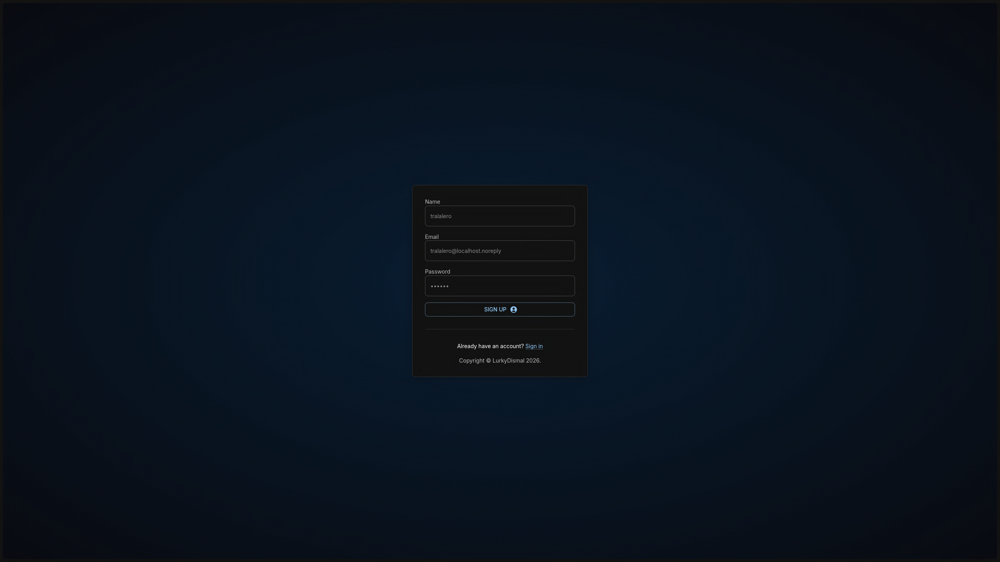
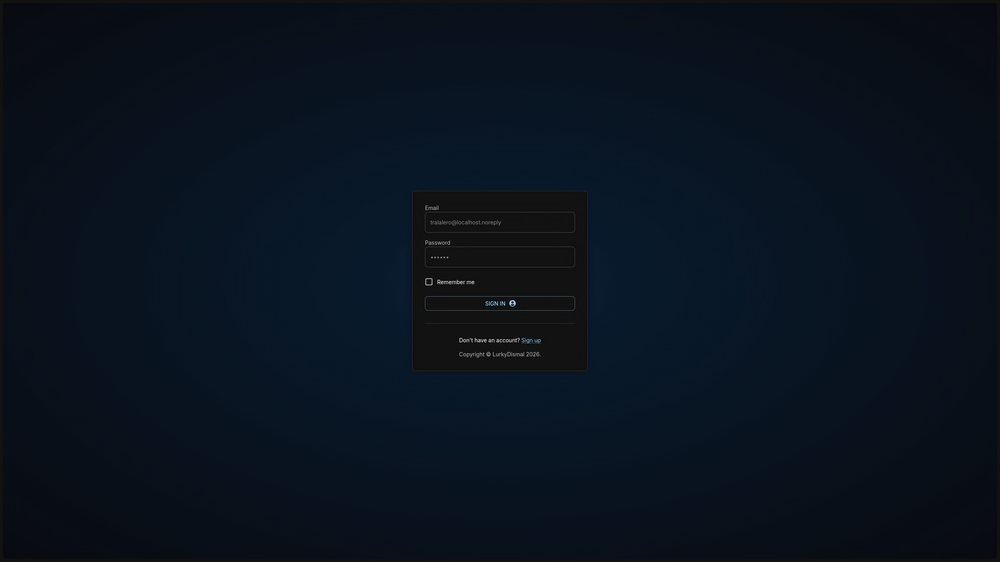
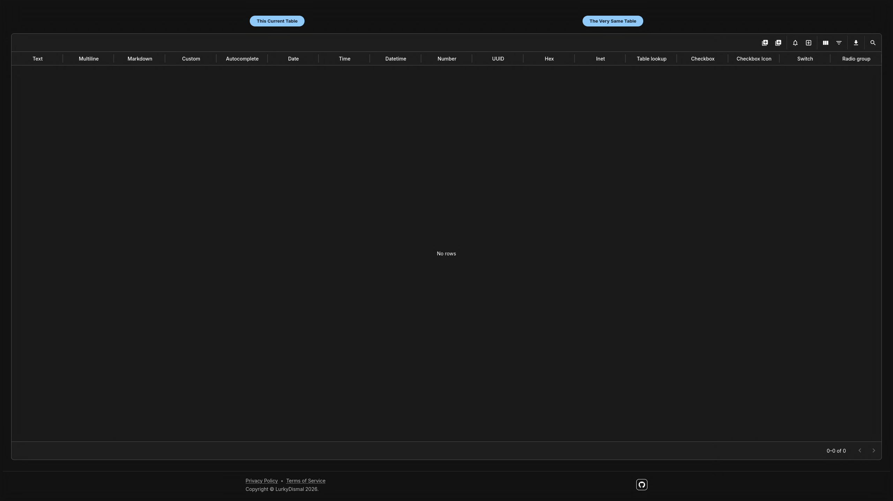
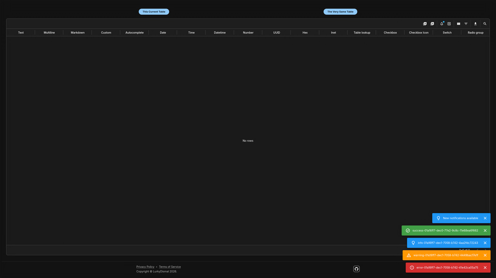
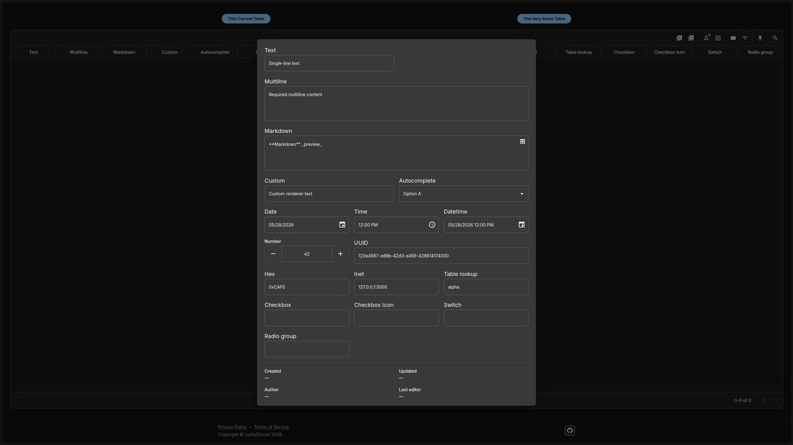
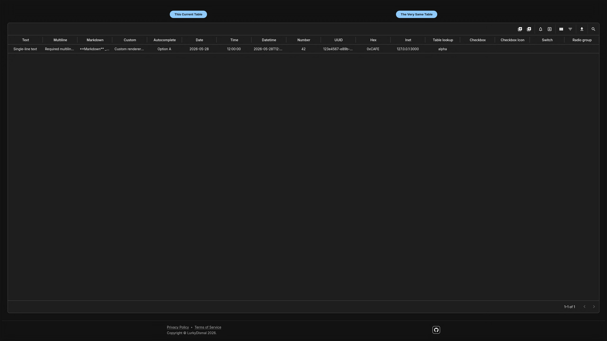
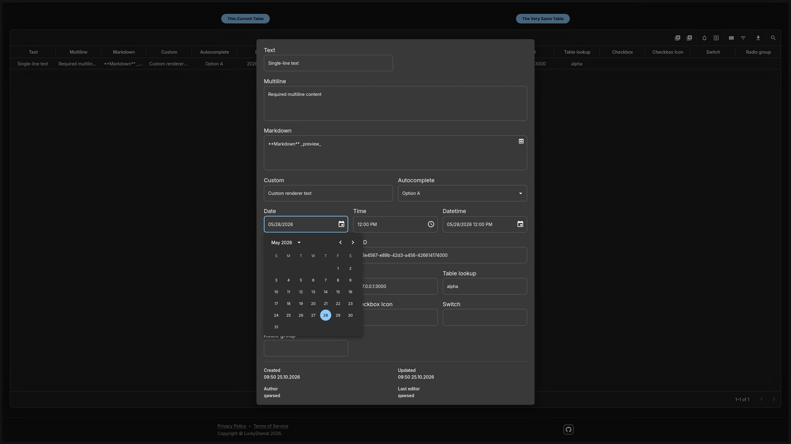
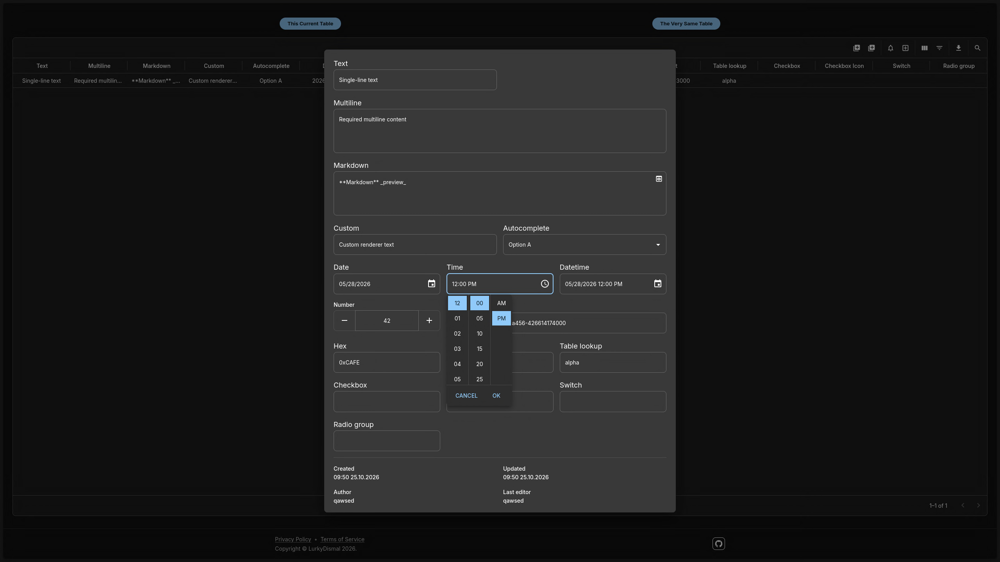
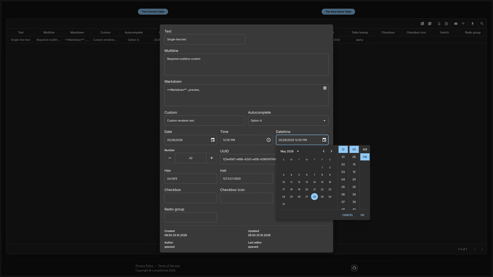
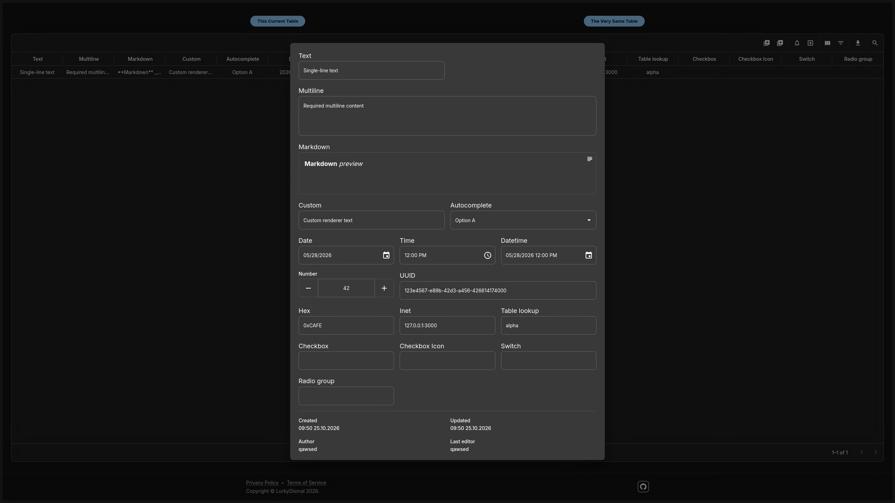

# Configurable Dashboard Engine

> A work-in-progress dashboard framework for building database-backed tables and forms from strongly typed configuration.

## Table of Contents

- [General Information](#general-information)
- [Technologies Used](#technologies-used)
- [Features](#features)

* [Screenshots](#screenshots)

- [Setup](#setup)
- [Usage](#usage)
- [Development Commands](#development-commands)
- [Project Status](#project-status)
- [Room for Improvement](#room-for-improvement)
- [License](#license)

## General Information

The Configurable Dashboard Engine provides reusable components for creating database-backed dashboard pages without implementing a separate table and form interface for every data model.

Developers define each table's fields and behavior through TypeScript configuration, then connect that configuration to shared data-grid components and server-side database actions. The included application demonstrates the engine with a sample table and includes authentication, database integration, notifications, and live dashboard-change events.

The project is a configurable framework for developers, not a finished visual dashboard builder. Adding a new dashboard still involves defining its data model, field configuration, and server actions in code.

## Technologies Used

- **Frontend:** Next.js App Router, React, TypeScript
- **UI:** Material UI (MUI), MUI X Data Grid, MUI X Date Pickers
- **Forms and validation:** React Hook Form, Zod, `@hookform/resolvers`
- **Database:** PostgreSQL, Drizzle ORM, Drizzle Kit
- **Authentication and server actions:** Better Auth, `next-safe-action`
- **Live updates:** Server-Sent Events (SSE)
- **Testing and code quality:** Vitest, Playwright, TypeScript, Fallow, Oxfmt
- **Deployment tooling:** Docker, Docker Compose, Caddy; an nginx configuration is also included

## Features

- **Configuration-driven data grids:** Reuse the same grid component across tables by supplying typed field definitions and data actions.
- **Configurable form fields:** Supports text, multiline text, Markdown, numeric, date, time, datetime, autocomplete, UUID, hexadecimal, IP/network, table-lookup, Boolean, radio-group, and custom-rendered fields.
- **Field behavior and validation:** Configure required fields, ranges, custom validation, asynchronous autocomplete options, dependent/interconnected fields, default values, and field-specific formatting.
- **Database operations:** Reusable server-side actions for reading, creating, and updating rows with Drizzle ORM and schema-based validation.
- **Table controls:** Quick search, column visibility, filtering controls, CSV export, and printing.
- **Change tracking:** Records author and last-editor metadata for row mutations.
- **Live updates and notifications:** SSE events notify connected clients about dashboard mutations and notification events.
- **Authentication:** Email/password registration and login through Better Auth, with protected dashboard routes and session-aware server-side operations.
- **Development and testing tools:** Unit tests, a Playwright end-to-end test configuration, and Docker-based PostgreSQL setup.

## Screenshots












## Setup

### Prerequisites

Install:

- Node.js
- pnpm
- Docker with the Docker Compose plugin

### 1. Clone the repository

```bash
git clone https://github.com/lurkydismal/template_next.git
cd template_next
```

### 2. Configure environment variables

Create a local environment file:

```bash
cp env.example .env
```

Edit `.env` and set the PostgreSQL credentials and connection values. For local development, the database host should normally remain `localhost` because PostgreSQL is published on port `5432` by Docker Compose.

Replace the example `BETTER_AUTH_SECRET` with a strong random value. For example, generate one with:

```bash
openssl rand -base64 32
```

Do not use the example credentials or placeholder secrets in a deployed environment, and do not commit your `.env` file.

### 3. Install dependencies

```bash
pnpm install
```

### 4. Start PostgreSQL

```bash
docker compose up -d postgres
```

Check that the database container is healthy before continuing.

### 5. Initialize the database schema

Apply the current Drizzle schema to the configured development database:

```bash
pnpm push
```

`pnpm push` synchronizes the schema directly with the database. It is convenient for initial development setup; review schema changes carefully when working with data you need to preserve. For migration-based workflows, use `pnpm generate` and `pnpm migrate` instead.

### 6. Start the development server

```bash
pnpm dev
```

Open [http://localhost:3000](http://localhost:3000).

The repository also includes a Dockerfile and Docker Compose definitions for the application and reverse proxy. The complete containerized deployment setup is still a work in progress; the local development steps above are the recommended starting point.

## Usage

### 1. Register and sign in

Open `/auth/register` to create an account, then sign in at `/auth/login`. The root route redirects to the configured post-login route.

### 2. Open the sample dashboard

Navigate to `/dashboard/tables` to view the example table. The page demonstrates the shared data grid and its form configuration.

### 3. Manage table data

Depending on the field configuration, the dashboard supports searching and filtering rows, changing visible columns, creating records, editing records in a form dialog, and exporting or printing the table. Available fields and behavior are controlled by the dashboard's configuration.

### 4. Configure a dashboard for another table

1. **Define the database model** in `src/db/schema.ts` and update the corresponding row types in `src/db/types.ts` as needed.
2. **Describe the fields** in a configuration file using the `FieldConfig` types from `src/components/TableDataGrid/RowDialog`. Field definitions can specify labels, input types, validation, defaults, layout, formatting, custom renderers, and field dependencies.
3. **Create table-specific server actions** that connect the table to the reusable operations in `src/lib/dashboard/common/function.ts`. The sample wrappers are in `src/lib/dashboard/tables/function.ts`.
4. **Render the grid** by passing the field configuration and row actions to `TableDataGrid` from a dashboard page.
5. **Update the database schema** and test the table and form behavior against the configured database.

This separates table-specific definitions from the reusable UI and data-handling logic. Some application code is still required for each new table; the current project does not provide a no-code dashboard editor.

## Development Commands

Run these commands from the project root.

| Command                  | Description                                                  |
| ------------------------ | ------------------------------------------------------------ |
| `pnpm dev`               | Start the Next.js development server.                        |
| `pnpm build`             | Build the production application.                            |
| `pnpm start`             | Start the built application.                                 |
| `pnpm test --run`        | Run the Vitest suite once.                                   |
| `pnpm format`            | Format source files using Oxfmt.                             |
| `pnpm format:check`      | Check formatting without modifying files.                    |
| `pnpm lint`              | Run Fallow static analysis.                                  |
| `pnpm exec tsc --noEmit` | Run TypeScript type checking.                                |
| `pnpm generate`          | Generate Drizzle migrations from schema changes.             |
| `pnpm migrate`           | Apply pending Drizzle migrations.                            |
| `pnpm push`              | Synchronize the schema directly with the database.           |
| `pnpm pull`              | Pull the database schema into the Drizzle schema definition. |

Playwright end-to-end tests are configured in `playwright.config.ts`. Install the required Chromium binaries and run the Chromium project with:

```bash
pnpm exec playwright install chromium chromium-headless-shell
pnpm exec playwright test --project=chromium
```

## Project Status

Project is: _in progress_.

The project currently includes a reusable configurable grid and form system, a sample dashboard, PostgreSQL/Drizzle integration, Better Auth authentication, and SSE-based event handling. It is not yet a complete general-purpose dashboard product, and parts of the configuration, tests, and deployment workflow still need refinement.

## Room for Improvement

- Complete file and image upload behavior, including previews and drag-and-drop support.
- Expand dashboard functionality with settings, charts, administration, and messaging features.
- Improve SSE reconnection and recovery, and use a shared event transport if the application is deployed across multiple server instances.
- Expand unit, integration, and end-to-end test coverage for table actions, authorization, validation, and live updates.
- Refactor duplicated logic and continue simplifying the field configuration API.
- Finish and document production deployment, environment handling, and operational safeguards.

## License

This project is open source and available under the [GNU Affero General Public License v3.0](LICENSE).
